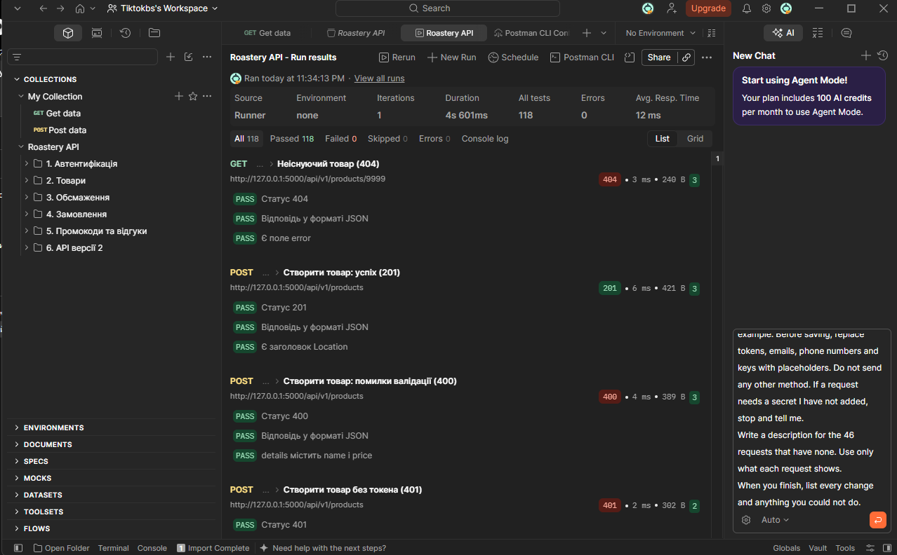
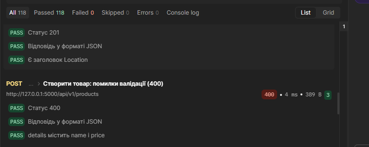
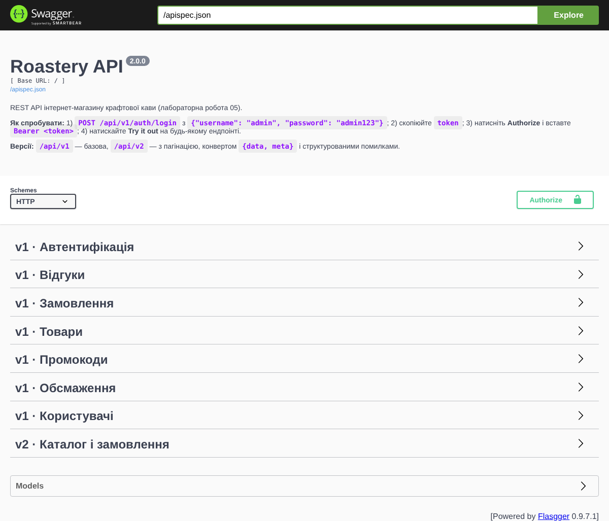
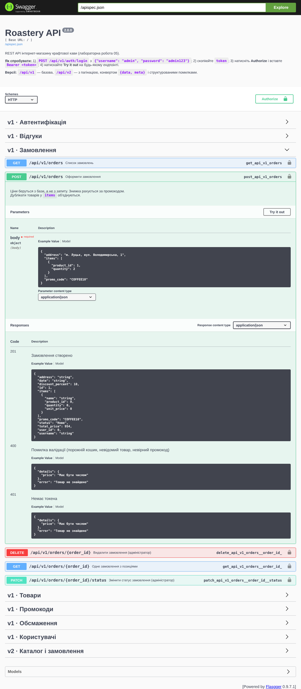
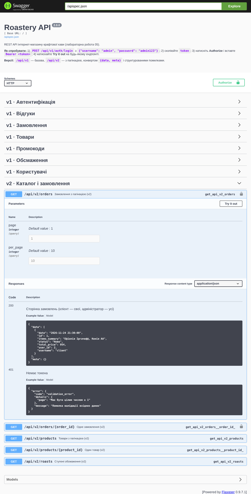
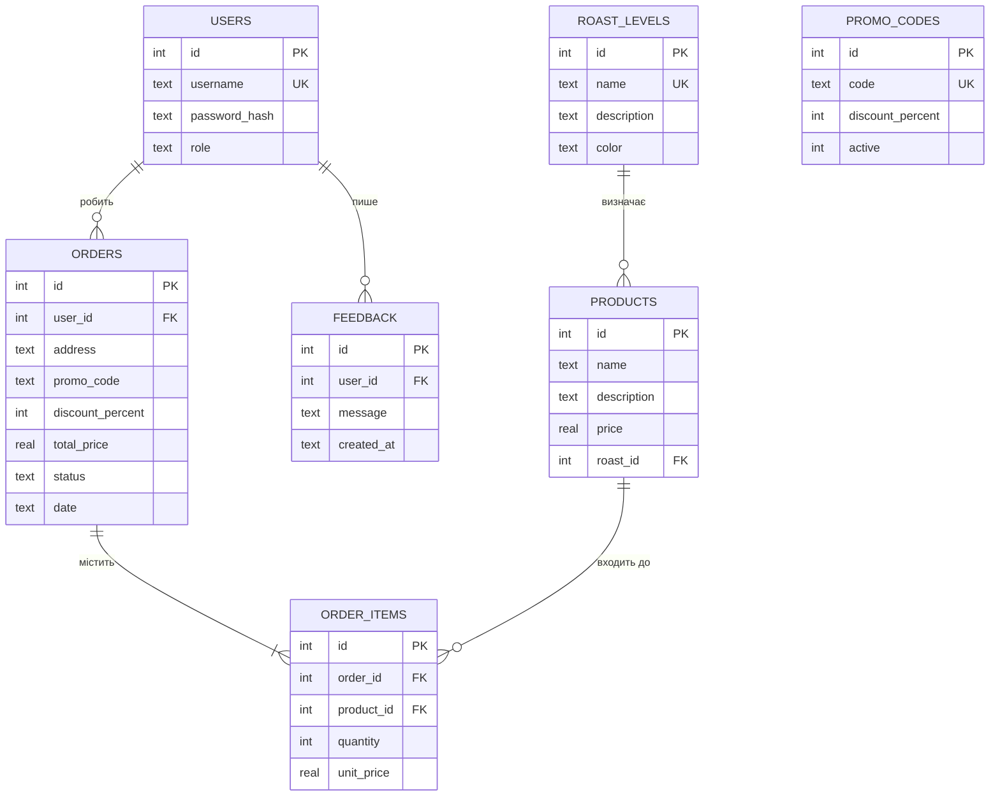

# Roastery: інтернет-магазин крафтової кави (сайт + REST API)

Лабораторні роботи 04 (база даних) і 05 (REST API). Flask + SQLite.

**Склад команди:** Наконечний Михайло, Бондар Роман, Данильчук Олександр. **Репозиторій:** https://github.com/misha808/coffee-roastery

## Запуск

```bash
python -m venv .venv
.venv\Scripts\activate          # Linux/macOS: source .venv/bin/activate
pip install -r requirements.txt
python app.py                    # http://127.0.0.1:5000
```

| Що | Адреса |
|----|--------|
| Сайт | http://127.0.0.1:5000/ |
| Документація API (Swagger UI) | http://127.0.0.1:5000/apidocs/ |
| REST API | http://127.0.0.1:5000/api/v1/… та /api/v2/… |

База `db.sqlite` створюється автоматично з демо-кавою (12 сортів), адміном і промокодом `COFFEE10`.
Адміністратор: `admin` / `admin123`. Тестовий клієнт з замовленням і відгуком: `python seed_data.py` (`client` / `client123`).

## Технології

Python 3, Flask 3, SQLite, **flasgger** (Swagger UI), `itsdangerous` (підписані токени), Postman / newman (тестування), `unittest` (автотести).

## Виконані рівні (лабораторна 05)

| Рівень | Вимога | Де виконано |
|--------|--------|-------------|
| 1 | Мінімум 6 endpoints, JSON, базова обробка помилок | **33 операцій** у `routes/api/` |
| 1 | Колекція в Postman, сценарії, результати | `postman/roastery.postman_collection.json`, розділ «Тестування» |
| 2 | Документація flasgger: endpoints, схеми, приклади | `/apidocs/`, YAML у docstring, схеми в `routes/api/docs.py` |
| 3 | Валідація вхідних даних | `validate()` у `routes/api/common.py` |
| 3 | Декілька версій API | `/api/v1` і `/api/v2` |
| 3 | Обробка помилок із кодами статусу | `ApiError`, JSON для всіх помилок на `/api/…` |
| 3+ | Автентифікація токеном, ролі, автотести | `routes/api/common.py`, `tests/test_api.py` |

## Принципи REST у проєкті

- **Ресурси й методи.** Адреси — іменники (`/products/3`), дія визначається методом: GET читає, POST створює (201 + заголовок `Location`), PUT замінює повністю, PATCH змінює частково, DELETE видаляє (204 без тіла).
- **Stateless.** Сервер не зберігає сесій для API: клієнт щоразу надсилає `Authorization: Bearer <token>`. Токен — підписаний (`itsdangerous`) і діє 24 години; роль користувача перевіряється в базі при кожному запиті.
- **JSON усюди**, зокрема для помилок: навіть неіснуюча адреса `/api/…` повертає JSON, а не HTML-сторінку.
- **Ціни й знижки рахує сервер.** У запиті на замовлення клієнт передає лише `product_id` і `quantity`.

### Як почати працювати з API

```bash
# 1. Отримати токен
curl -X POST http://127.0.0.1:5000/api/v1/auth/login -H "Content-Type: application/json" -d "{\"username\":\"admin\",\"password\":\"admin123\"}"

# 2. Публічний запит
curl "http://127.0.0.1:5000/api/v1/products?q=шоколад&sort=price_asc"

# 3. Захищений запит
curl -X POST http://127.0.0.1:5000/api/v1/orders -H "Authorization: Bearer <token>" -H "Content-Type: application/json" -d "{\"address\":\"Луцьк, вул. Володимирська, 1\",\"promo_code\":\"COFFEE10\",\"items\":[{\"product_id\":1,\"quantity\":2}]}"
```

## Таблиця endpoints

**v1 · Автентифікація**

| Метод | Адреса | Призначення | Доступ | Коди відповідей |
|-------|--------|-------------|--------|-----------------|
| POST | `/api/v1/auth/login` | Вхід: отримати токен | — | 200, 400, 401 |
| POST | `/api/v1/auth/register` | Реєстрація клієнта | — | 201, 400, 409 |
| GET | `/api/v1/me` | Поточний користувач | токен | 200, 401 |

**v1 · Товари**

| Метод | Адреса | Призначення | Доступ | Коди відповідей |
|-------|--------|-------------|--------|-----------------|
| GET | `/api/v1/products` | Список товарів із пошуком, фільтром і сортуванням | — | 200, 400 |
| POST | `/api/v1/products` | Створити товар | admin | 201, 400, 401, 403 |
| GET | `/api/v1/products/{product_id}` | Один товар | — | 200, 404 |
| PUT | `/api/v1/products/{product_id}` | Повністю замінити товар | admin | 200, 400, 401, 403, 404 |
| PATCH | `/api/v1/products/{product_id}` | Частково оновити товар | admin | 200, 400, 401, 403, 404 |
| DELETE | `/api/v1/products/{product_id}` | Видалити товар | admin | 204, 401, 403, 404, 409 |

**v1 · Обсмаження**

| Метод | Адреса | Призначення | Доступ | Коди відповідей |
|-------|--------|-------------|--------|-----------------|
| GET | `/api/v1/roasts` | Ступені обсмаження | — | 200 |
| POST | `/api/v1/roasts` | Створити обсмаження | admin | 201, 400, 401, 403, 409 |
| GET | `/api/v1/roasts/{roast_id}` | Одне обсмаження | — | 200, 404 |
| PUT | `/api/v1/roasts/{roast_id}` | Оновити обсмаження | admin | 200, 400, 401, 403, 404, 409 |
| DELETE | `/api/v1/roasts/{roast_id}` | Видалити обсмаження | admin | 204, 401, 403, 404, 409 |

**v1 · Замовлення**

| Метод | Адреса | Призначення | Доступ | Коди відповідей |
|-------|--------|-------------|--------|-----------------|
| GET | `/api/v1/orders` | Список замовлень | токен | 200, 401 |
| POST | `/api/v1/orders` | Оформити замовлення | токен | 201, 400, 401 |
| GET | `/api/v1/orders/{order_id}` | Одне замовлення з позиціями | токен | 200, 401, 404 |
| DELETE | `/api/v1/orders/{order_id}` | Видалити замовлення | admin | 204, 401, 403, 404 |
| PATCH | `/api/v1/orders/{order_id}/status` | Змінити статус замовлення | admin | 200, 400, 401, 403, 404 |

**v1 · Промокоди**

| Метод | Адреса | Призначення | Доступ | Коди відповідей |
|-------|--------|-------------|--------|-----------------|
| GET | `/api/v1/promos` | Усі промокоди | admin | 200, 401, 403 |
| POST | `/api/v1/promos` | Створити промокод | admin | 201, 400, 401, 403, 409 |
| GET | `/api/v1/promos/validate` | Перевірити промокод | — | 200, 404 |
| DELETE | `/api/v1/promos/{promo_id}` | Видалити промокод | admin | 204, 401, 403, 404 |

**v1 · Відгуки**

| Метод | Адреса | Призначення | Доступ | Коди відповідей |
|-------|--------|-------------|--------|-----------------|
| GET | `/api/v1/feedback` | Відгуки клієнтів | — | 200 |
| POST | `/api/v1/feedback` | Залишити відгук | токен | 201, 400, 401 |
| DELETE | `/api/v1/feedback/{feedback_id}` | Видалити відгук | admin | 204, 401, 403, 404 |

**v1 · Користувачі**

| Метод | Адреса | Призначення | Доступ | Коди відповідей |
|-------|--------|-------------|--------|-----------------|
| GET | `/api/v1/users` | Користувачі | admin | 200, 401, 403 |
| PATCH | `/api/v1/users/{user_id}/role` | Змінити роль користувача | admin | 200, 400, 401, 403, 404, 409 |

**v2 · Каталог і замовлення**

| Метод | Адреса | Призначення | Доступ | Коди відповідей |
|-------|--------|-------------|--------|-----------------|
| GET | `/api/v2/orders` | Замовлення з пагінацією (v2) | токен | 200, 401 |
| GET | `/api/v2/orders/{order_id}` | Одне замовлення (v2) | токен | 200, 401, 404 |
| GET | `/api/v2/products` | Товари з пагінацією (v2) | — | 200, 400 |
| GET | `/api/v2/products/{product_id}` | Один товар (v2) | — | 200, 404 |
| GET | `/api/v2/roasts` | Ступені обсмаження (v2) | — | 200 |

Позначка **токен** означає будь-якого авторизованого користувача, **admin** — лише адміністратора. Клієнт бачить тільки свої замовлення; чужі повертають 404.

## Версії API

| | `/api/v1` | `/api/v2` |
|---|---|---|
| Список | масив `[...]` | `{"data": [...], "meta": {"page", "per_page", "total", "pages"}}` |
| Обсмаження товару | `roast_id`, `roast_name` | вкладений об'єкт `roast: {id, name, color}` |
| Пагінація | немає | `?page=1&per_page=10` (1–50) |
| Помилка | `{"error": "текст", "details": {...}}` | `{"error": {"code", "message", "details"}}` |
| Заголовок | `X-API-Version: 1` | `X-API-Version: 2` |

Версія 2 змінює формат читання (товари, обсмаження, замовлення); запис (POST/PUT/PATCH/DELETE) лишається у v1, щоб старі клієнти не ламалися.

## Валідація і помилки

Усі помилки валідації збираються разом і повертаються з кодом **400** та описом кожного поля:

```json
{
  "error": "Помилка валідації вхідних даних",
  "details": {"name": "Не може бути порожнім", "price": "Має бути числом"}
}
```

| Код | Коли |
|-----|------|
| 400 | некоректний JSON, помилка валідації, невідомий статус, невірний промокод, порожній кошик |
| 401 | немає токена, токен недійсний або прострочений, невірний пароль |
| 403 | клієнт викликає адміністративну дію |
| 404 | ресурс не існує або чуже замовлення |
| 405 | метод не дозволений для адреси |
| 409 | дублікат (логін, промокод, обсмаження), видалення товару із замовлень, зміна власної ролі |
| 500 | внутрішня помилка (також JSON) |

Правила валідації: рядки обрізаються по краях, перевіряється довжина і формат; `price` — число від 0 до 100000 (булеві значення й `NaN` відхиляються); `quantity` — ціле від 1 до 99; `color` — `#rrggbb`; пароль не менше 6 символів; існування `roast_id` і `product_id` перевіряється в базі.

## Тестування

### Postman

1. Postman → **Import** → файл `postman/roastery.postman_collection.json`.
2. Запустіть застосунок (`python app.py`) на чистій базі.
3. Правою кнопкою на колекції → **Run collection**. Запити виконуються по порядку: токени та id зберігаються у змінних колекції.

Колекція містить **46 запитів у 6 папках** (автентифікація, товари, обсмаження, замовлення, промокоди й відгуки, API v2). У кожного запиту є тести (`pm.test`): код статусу, JSON, структура відповіді. Для кожного ендпоінта є і успішний сценарій, і помилка (неіснуючий ID, порожнє поле, немає токена, чужа роль, дублікат).

**Результат прогону** (консольний запуск `newman`, повний лог у `docs/postman-run-results.txt`):

| | виконано | помилок |
|---|---|---|
| запити | 46 | 0 |
| тест-скрипти | 46 | 0 |
| перевірки (assertions) | 118 | 0 |

**Скріншоти з Postman:**

| Успішний запит (201 Created) | Запит з помилкою (400 / 404) |
|---|---|
|  |  |

### Автотести

```bash
python -m unittest -v
```

28 тестів (на тимчасовій базі): вхід і токени, ролі (401/403), CRUD товарів і обсмажень, валідація, замовлення з промокодом, видимість чужих замовлень, версії v1/v2, пагінація, JSON для 404/405, доступність Swagger.

## Документація API

Swagger UI: **http://127.0.0.1:5000/apidocs/** (специфікація в JSON: `/apispec.json`). Опис кожного endpoint, схеми запитів і відповідей, приклади тіла запиту та кнопка **Try it out**. Для захищених запитів натисніть **Authorize** і вставте `Bearer <token>`.







## Структура проєкту

```
├── app.py                 # застосунок, реєстрація Blueprint, Swagger, JSON-помилки
├── models.py              # схема БД і функції доступу до даних
├── routes/
│   ├── auth.py shop.py feedback.py admin.py   # вебсайт (лаб. 04)
│   └── api/
│       ├── __init__.py    # Blueprint v1 і v2
│       ├── common.py      # помилки, токени, валідація, серіалізація, пагінація
│       ├── auth.py        # реєстрація, вхід, /me
│       ├── catalog.py     # товари та обсмаження
│       ├── orders.py      # замовлення
│       ├── extras.py      # промокоди, відгуки, користувачі
│       ├── v2.py          # версія 2
│       └── docs.py        # схеми Swagger
├── postman/               # колекція Postman
├── tests/test_api.py      # автотести
├── docs/                  # скріншоти й лог прогону
├── templates/ static/     # вебсайт
└── lab-reports/           # звіти до лабораторної 04
```

API використовує ті самі функції `models.py`, що й сайт, тому правила цілісності даних однакові: ціна на момент покупки в `unit_price`, `ON DELETE RESTRICT` для товарів із замовленнями, транзакція при створенні замовлення.

## Схема бази даних



## Розподіл роботи

| Учасник | Лаб. 04 | Лаб. 05 |
|---------|---------|---------|
| Наконечний Михайло | БД, авторизація, ролі, стиль | `routes/api/common.py`, `auth.py`, `docs.py`, інтеграція в `app.py`, README |
| Бондар Роман | каталог, кошик, замовлення | `routes/api/catalog.py`, `v2.py`, `tests/test_api.py` |
| Данильчук Олександр | адмін-панель | `routes/api/orders.py`, `extras.py`, колекція Postman |

## Висновки

У ході роботи ми розробили REST API для магазину з 33 операціями у двох версіях, які працюють поверх тієї самої бази даних, що й сайт. API повертає JSON (зокрема для помилок), використовує правильні HTTP-методи й коди статусу та не зберігає стану між запитами: автентифікація виконується підписаним токеном. Вхідні дані перевіряються на сервері, а всі помилки валідації повертаються одразу з описом полів. Протестували API колекцією Postman (46 запитів, 118 перевірок) та автотестами, а документацію зробили в Swagger UI за допомогою flasgger. Ми зрозуміли, чим версіонування допомагає змінювати формат відповідей, не ламаючи наявних клієнтів.
