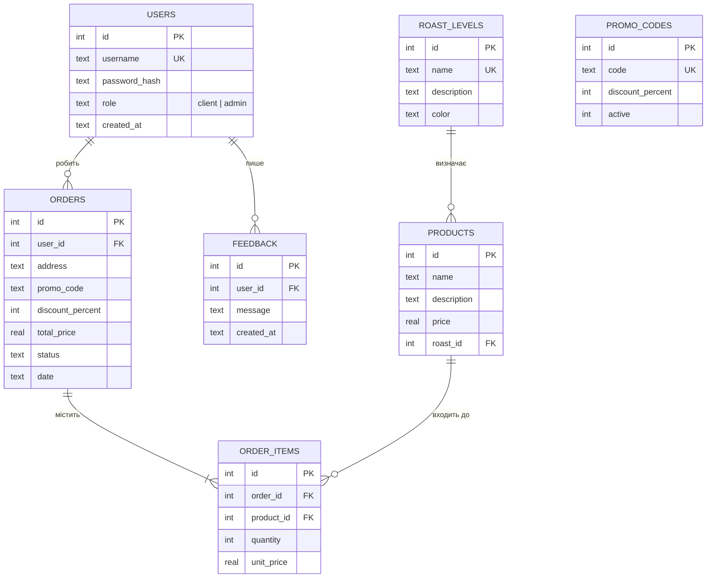

# Roastery — інтернет-магазин крафтової кави

Лабораторна робота 04: Flask + SQLite. Реалізовано **рівні 1, 2 і 3**.

## Запуск

Потрібен Python 3.10+.

```bash
python -m venv .venv
source .venv/bin/activate        # Windows: .venv\Scripts\activate
pip install -r requirements.txt

python seed_data.py              # тестовий клієнт, замовлення, відгук (необов'язково)
python app.py                    # http://127.0.0.1:5000
```

База `db.sqlite` створюється автоматично разом із демо-кавою (6 сортів), адміном і промокодом `COFFEE10`.
Щоб почати з чистої бази, видаліть цей файл.

| Роль | Логін | Пароль |
|------|-------|--------|
| Адміністратор | `admin` | `admin123` (змінюється через `ADMIN_USERNAME` / `ADMIN_PASSWORD`) |
| Клієнт (після `seed_data.py`) | `client` | `client123` |

Промокоди з seed: `COFFEE10` (−10%), `WELCOME20` (−20%).

## Що реалізовано

**Рівень 1**
- таблиця `feedback`, додавання відгуків, перегляд і видалення в адмінці;
- таблиці `products`, `orders`, `order_items` (зв'язок «багато-до-багатьох»);
- кошик у сесії, оформлення замовлення однією транзакцією;
- статуси замовлень (6 станів), адмін-панель для товарів (додати / змінити / видалити) і замовлень.

**Рівень 2**
- додаткова таблиця `roast_levels` (ступені обсмаження) з повним CRUD в адмінці;
  колір обсмаження зберігається в БД і малює шкалу фільтра на сайті;
- видалити обсмаження, до якого прив'язані товари, не можна (`ON DELETE RESTRICT`).

**Рівень 3** (реалізовано чотири функції замість двох)
1. Ролі `client` / `admin`: реєстрація, вхід, хеші паролів (`werkzeug.security`), захист адмін-панелі, керування ролями.
2. Історія замовлень клієнта (`/orders`); чужі замовлення недоступні.
3. Пошук (кирилиця без урахування регістру), фільтр за обсмаженням і сортування каталогу.
4. Промокоди зі знижкою: створення, вимкнення, видалення в адмінці; застосування в кошику.

## Структура

```
├── app.py            # застосунок, конфігурація, реєстрація Blueprint
├── models.py         # схема БД і всі функції доступу до даних
├── init_db.py        # ручне створення таблиць
├── seed_data.py      # тестові дані
├── routes/
│   ├── auth.py       # реєстрація, вхід, декоратори ролей
│   ├── shop.py       # каталог, кошик, промокоди, замовлення клієнта
│   ├── feedback.py   # відгуки
│   └── admin.py      # адмін-панель
├── templates/        # шаблони (admin/ — адмін-панель)
├── static/style.css  # єдиний стиль
└── lab-reports/      # звіти учасників
```

## Схема бази даних



`promo_codes` не має зовнішніх ключів: код і відсоток копіюються в замовлення, щоб історія не змінювалася після зміни промокоду.

## Технічні рішення (для захисту)

- Одне з'єднання на запит (`g`), закриття в `teardown_appcontext`, `PRAGMA foreign_keys = ON`.
- Усі запити параметризовані (`?`); сортування — через білий список, а не підстановку рядка від користувача.
- Транзакції (`with db:`): замовлення й позиції пишуться разом.
- `ON DELETE CASCADE` для позицій замовлення, `RESTRICT` для товарів, обсмажень і користувачів із замовленнями.
- Ціни й знижка рахуються на сервері з бази, а не з даних форми; ціна на момент покупки зберігається в `unit_price`.
- Паролі лише у вигляді хешу; `session.clear()` при вході; перенаправлення `next` лише на внутрішні адреси.
- Дії, що змінюють дані, — лише через POST (включно з виходом).
- Пошук кирилицею: власна SQL-функція `py_lower`, бо `LIKE` у SQLite нечутливий до регістру лише для латиниці.

## Що навмисно не входить

CSRF-токени (у реальному проєкті — Flask-WTF), міграції схеми (після зміни схеми видаліть `db.sqlite`), онлайн-оплата.
