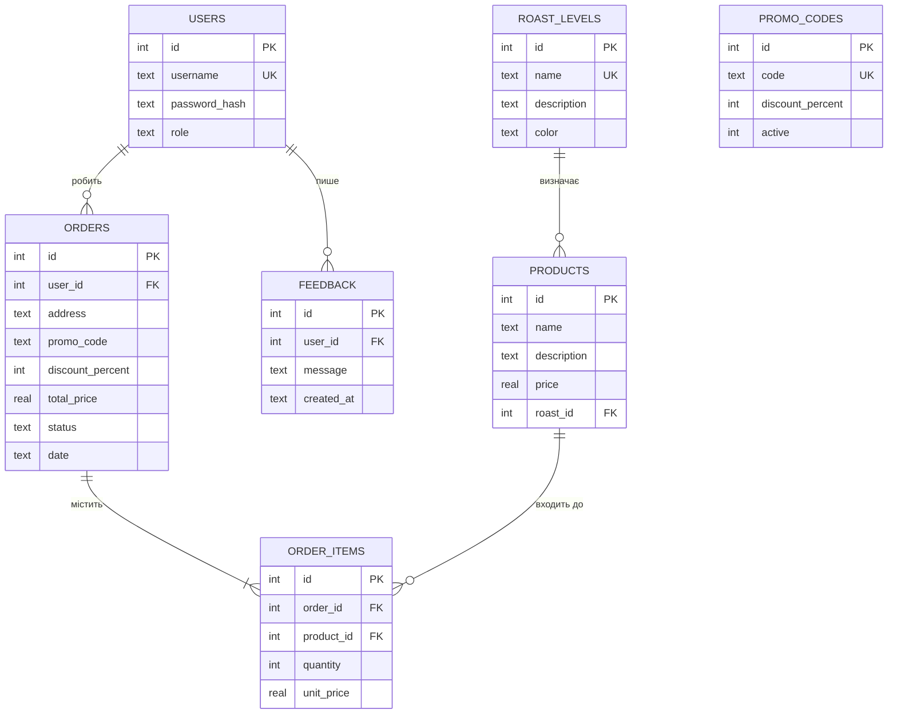
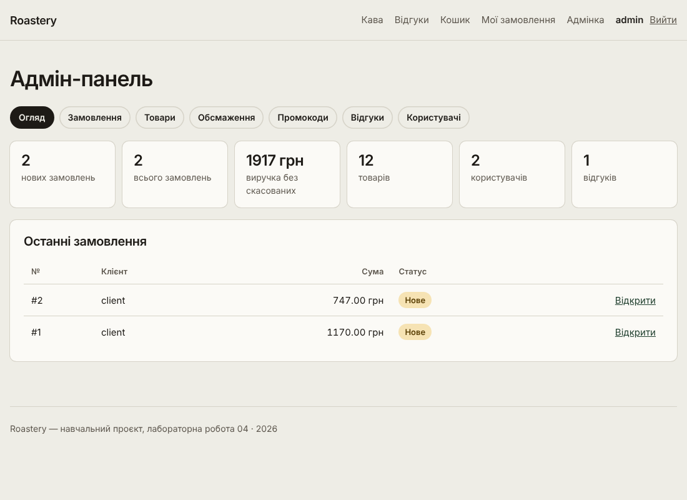
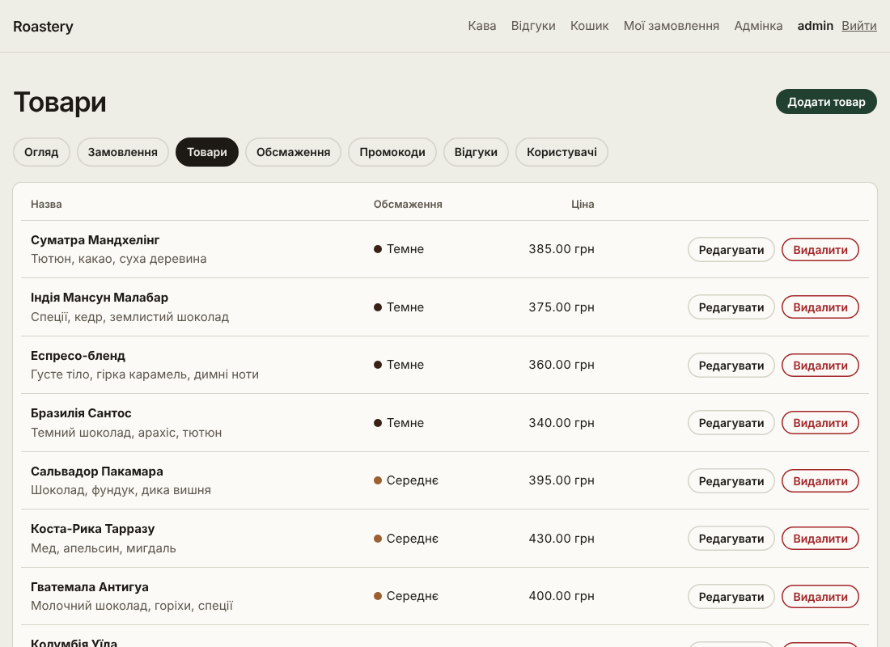
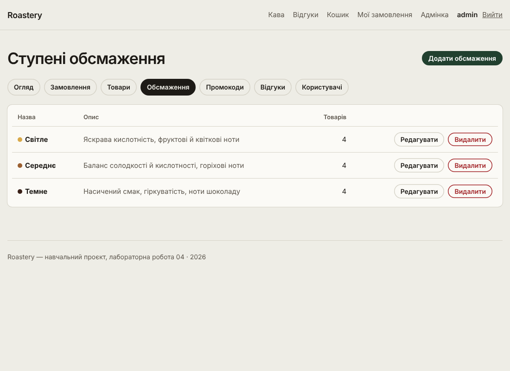
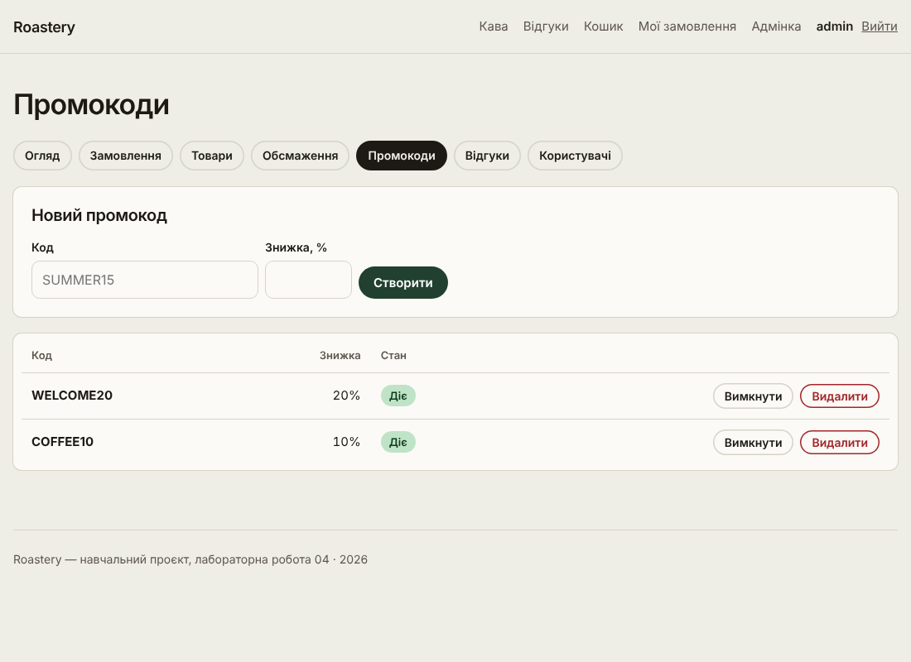
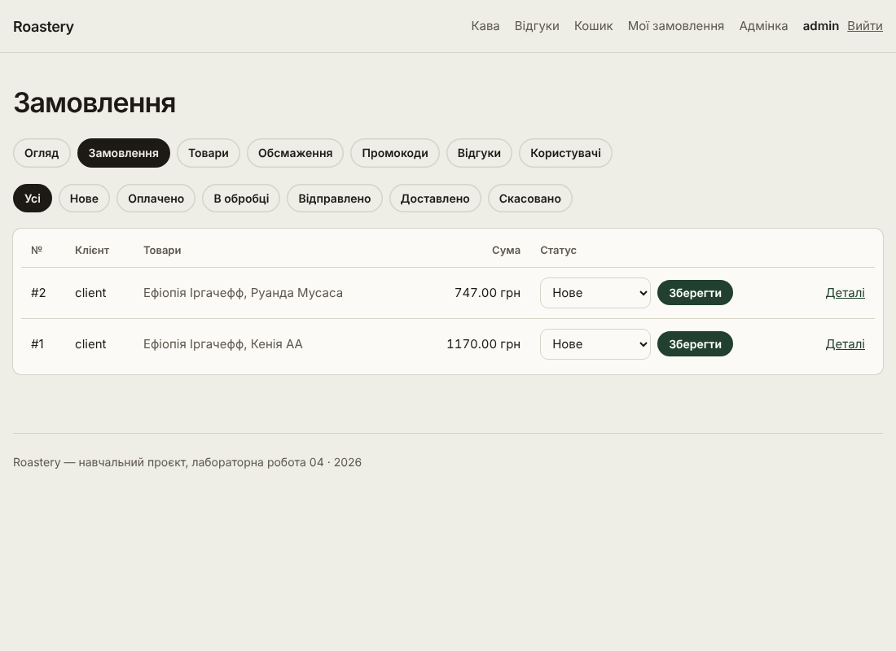
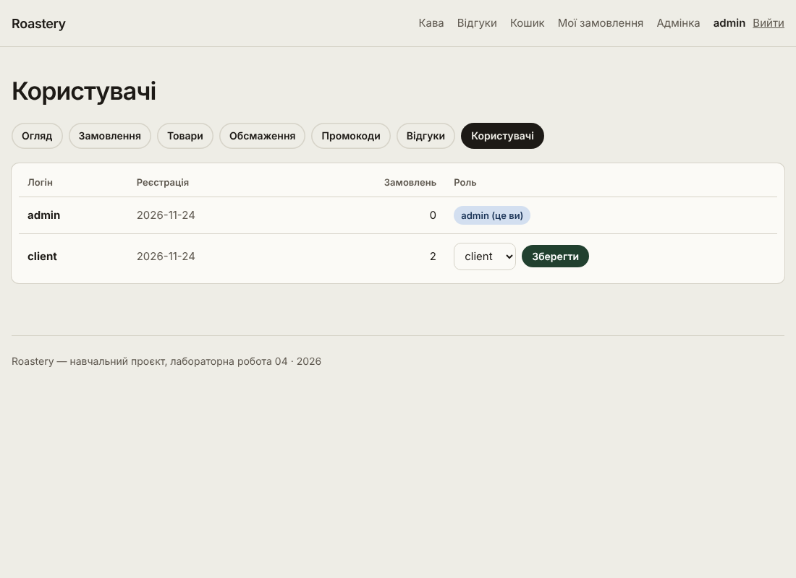
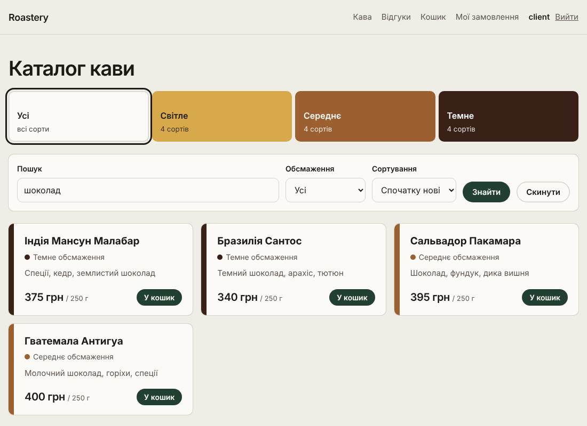
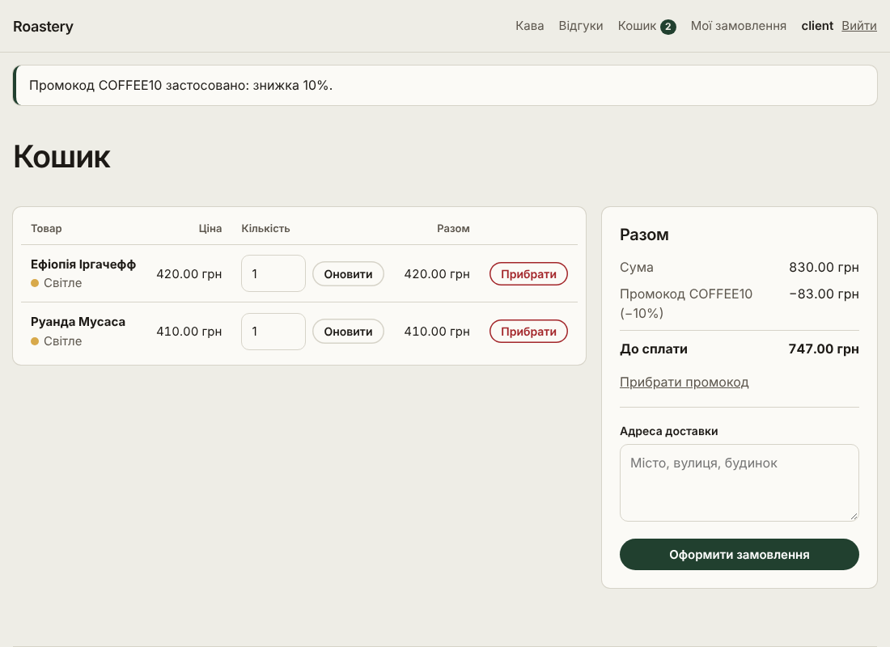
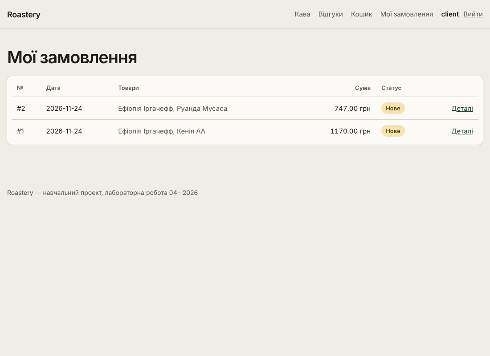

# Лабораторна робота 04. Реалізація бази даних для вебпроєкту

**ПІБ:** Бондар Роман Олегович
**Група:** ІПЗ 21
**Склад команди:** Михайло, Роман, Олександр
**Тема проєкту:** інтернет-магазин крафтової кави «Roastery» (Flask + SQLite)
**Репозиторій:** [https://github.com/misha808/coffee-roastery](https://github.com/misha808/coffee-roastery)

## Особистий внесок

**Роль у команді:** Клієнтська частина: каталог, кошик, замовлення.

**Мої файли:** `routes/shop.py`, `routes/feedback.py`, `templates/home.html`, `shop.html`, `cart.html`, `orders.html`, `order_details.html`, `feedback.html`, `_macros.html`.

**Що зроблено:**
- Реалізував каталог із пошуком за назвою й описом, фільтром за обсмаженням і сортуванням за ціною та назвою (рівень 3).
- Зробив кошик у сесії (додавання, зміна кількості, видалення) і оформлення замовлення: замовлення та його позиції записуються однією транзакцією.
- Додав застосування промокодів у кошику (рівень 3): знижка рахується на сервері, код перевіряється заново при кожному перегляді кошика.
- Зробив історію замовлень клієнта (`/orders`): клієнт бачить лише свої замовлення.
- Реалізував відгуки: читати можуть усі, писати лише авторизовані; є перевірка довжини на сервері.

**Мої коміти:** [https://github.com/misha808/coffee-roastery/commit/88bb33a](https://github.com/misha808/coffee-roastery/commit/88bb33a) (каталог, кошик, промокоди, історія замовлень, відгуки)

## Схема бази даних

| Таблиця | Призначення | Ключі та зв'язки |
|---------|-------------|------------------|
| `users` | користувачі й ролі (`client` / `admin`) | PK `id`, унікальний `username` |
| `roast_levels` | ступені обсмаження кави (рівень 2) | PK `id`, унікальна `name` |
| `products` | товари (кава) | FK `roast_id` → `roast_levels` (`ON DELETE RESTRICT`) |
| `feedback` | відгуки клієнтів | FK `user_id` → `users` (`ON DELETE CASCADE`) |
| `promo_codes` | промокоди зі знижкою (рівень 3) | унікальний `code` |
| `orders` | замовлення | FK `user_id` → `users`; код і % знижки копіюються в замовлення |
| `order_items` | позиції замовлення | FK `order_id` → `orders` (`CASCADE`), FK `product_id` → `products` (`RESTRICT`) |

Зв'язок «багато-до-багатьох» між замовленнями й товарами реалізовано через проміжну таблицю `order_items`; у ній зберігається ціна на момент покупки (`unit_price`).

### Скріншоти

**Огляд адмін-панелі**

**Товари (додати / редагувати / видалити)**

**Ступені обсмаження: додаткова таблиця, рівень 2**

**Промокоди**

**Замовлення й керування статусами**

**Користувачі та ролі**

**Каталог із пошуком і фільтром**

**Кошик із промокодом**

**Історія замовлень клієнта**

## Труднощі та їх вирішення

1. **Пошук кирилицею.** `LIKE` у SQLite нечутливий до регістру лише для латиниці, тому «Шоколад» і «шоколад» не збігалися. Рішення: власна SQL-функція `py_lower`, зареєстрована через `create_function`.
2. **Довіра до даних браузера.** Ціни не можна брати з форми чи сесії. Рішення: у кошику зберігаються лише id та кількість, а ціни щоразу беруться з бази.
3. **Чужі замовлення.** Клієнт міг би відкрити `/orders/5` іншого користувача. Рішення: перевірка власника, для чужого замовлення повертається 404.
4. **Git.** Спочатку термінал відкрився не в тій папці (випадковий репозиторій у домашній теці). Рішення: перейшов у клон проєкту командою `cd` і перевірив `git status`.

## Висновки

Я навчився будувати повний шлях покупки: від каталогу до замовлення в базі. Зрозумів, що всі розрахунки та перевірки мають виконуватися на сервері, а не довірятися даним форми.
