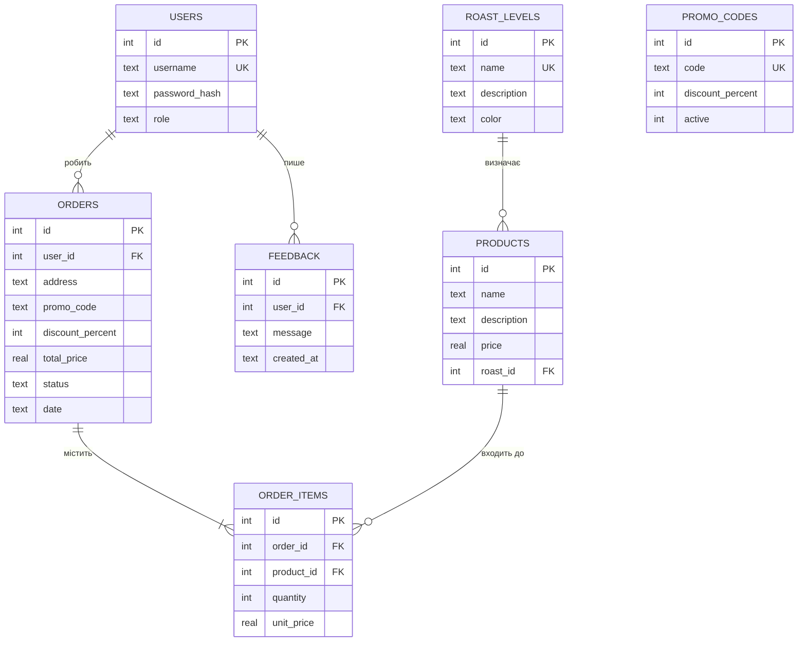
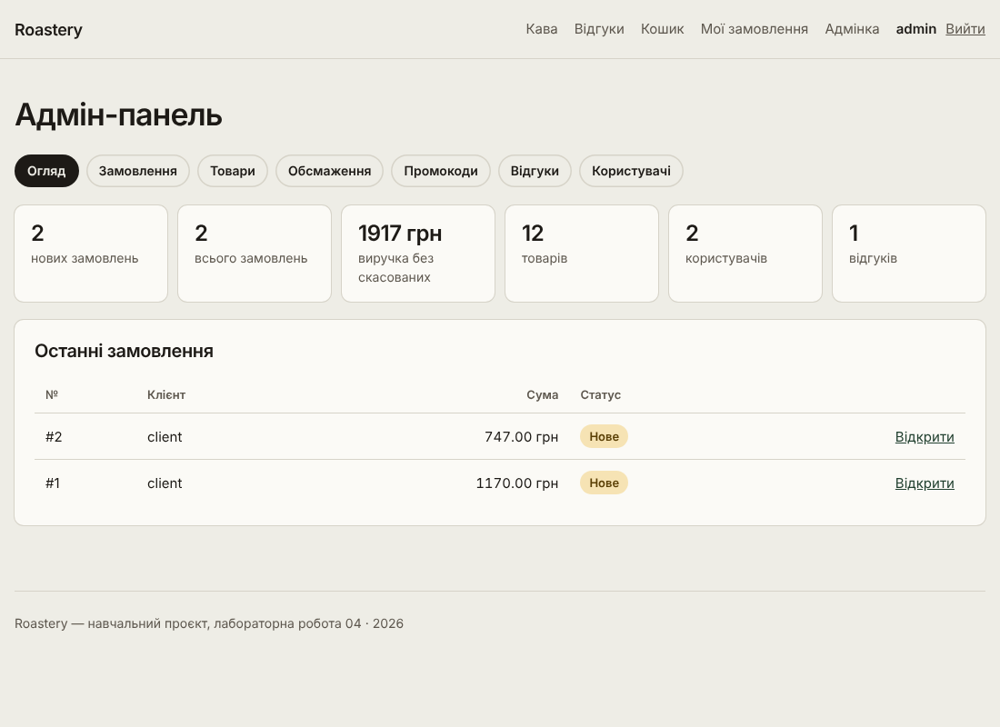
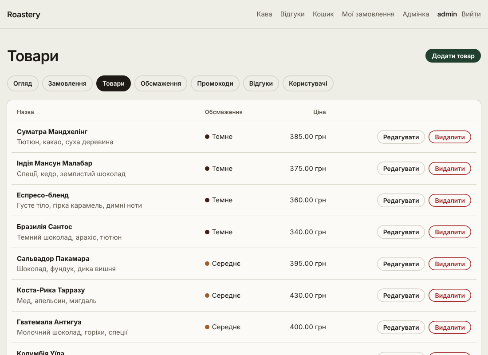
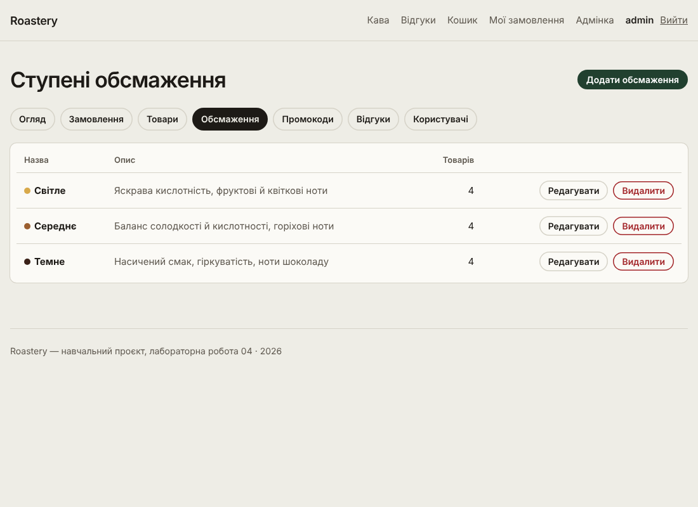
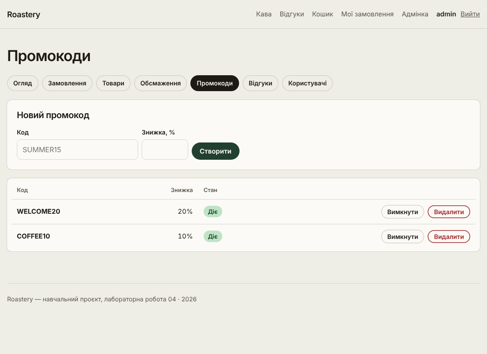
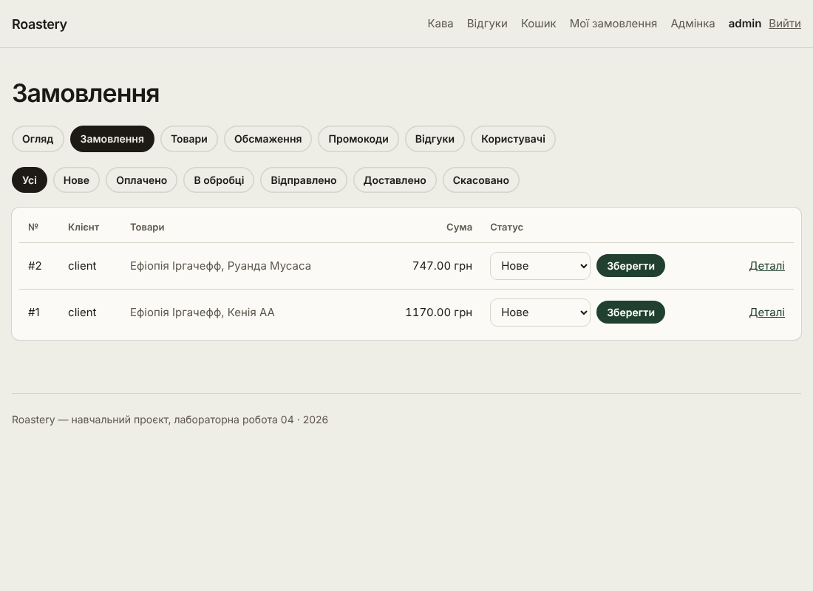
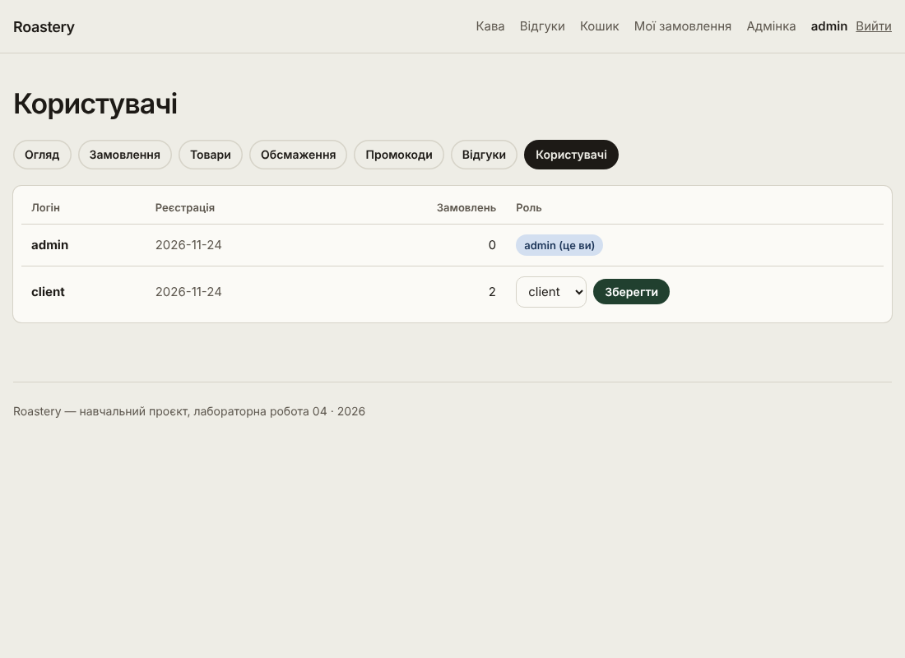
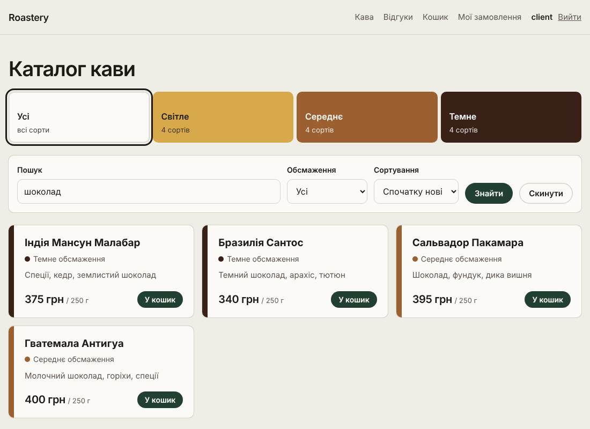
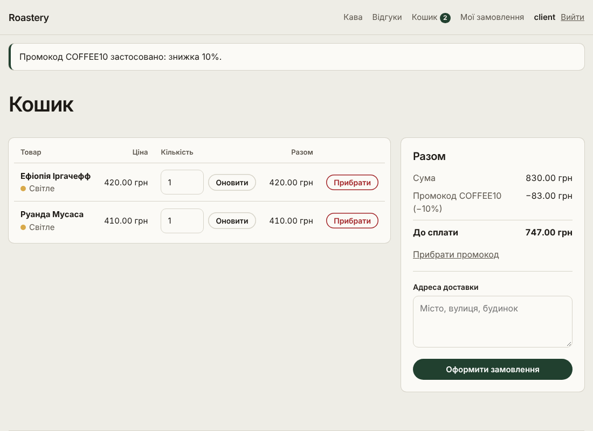
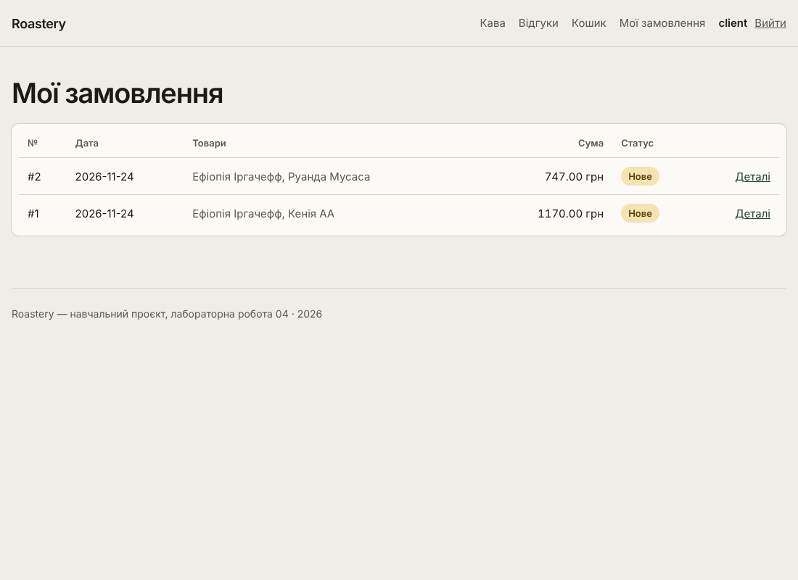

# Лабораторна робота 04. Реалізація бази даних для вебпроєкту

**ПІБ:** Данильчук Олександр
**Група:** ІПЗ-21
**Склад команди:** Наконечний Михайло, Бондар Роман, Данильчук Олександр
**Тема проєкту:** інтернет-магазин крафтової кави «Roastery» (Flask + SQLite)
**Репозиторій:** [https://github.com/misha808/coffee-roastery](https://github.com/misha808/coffee-roastery)

## Особистий внесок

**Роль у команді:** Адмін-панель.

**Мої файли:** `routes/admin.py`, `templates/admin/*` (огляд, замовлення, товари, обсмаження, промокоди, відгуки, користувачі).

**Що зроблено:**
- Зробив адмін-панель, доступну лише адміністраторам (`before_request` із перевіркою ролі).
- Реалізував повний CRUD товарів: додавання, редагування, видалення з перевіркою введених даних.
- Реалізував рівень 2: повний CRUD таблиці «Ступені обсмаження» із вибором кольору, який відображається на сайті.
- Додав керування замовленнями (список, фільтр за статусом, деталі, зміна статусу, видалення), промокодами (створення, вимкнення, видалення), відгуками (перегляд, видалення) та ролями користувачів.
- Зробив огляд із лічильниками: нові замовлення, виручка, кількість товарів і користувачів.

**Мої коміти:** [посилання на мій коміт](ВСТАВТЕ_ПОСИЛАННЯ_НА_КОМІТ) (адмін-панель: товари, обсмаження, промокоди, замовлення)

## Схема бази даних

| Таблиця | Призначення | Ключі та зв'язки |
|---------|-------------|------------------|
| `users` | користувачі й ролі (`client` / `admin`) | PK `id`, унікальний `username` |
| `roast_levels` | ступені обсмаження кави (рівень 2) | PK `id`, унікальна `name` |
| `products` | товари (кава) | FK `roast_id` → `roast_levels` (`ON DELETE RESTRICT`) |
| `feedback` | відгуки клієнтів | FK `user_id` → `users` (`ON DELETE CASCADE`) |
| `promo_codes` | промокоди зі знижкою (рівень 3) | унікальний `code` |
| `orders` | замовлення | FK `user_id` → `users`; код і % знижки копіюються в замовлення |
| `order_items` | позиції замовлення | FK `order_id` → `orders` (`CASCADE`), FK `product_id` → `products` (`RESTRICT`) |

Зв'язок «багато-до-багатьох» між замовленнями й товарами реалізовано через проміжну таблицю `order_items`; у ній зберігається ціна на момент покупки (`unit_price`).

### Скріншоти

**Огляд адмін-панелі**

**Товари (додати / редагувати / видалити)**

**Ступені обсмаження: додаткова таблиця, рівень 2**

**Промокоди**

**Замовлення й керування статусами**

**Користувачі та ролі**

**Каталог із пошуком і фільтром**

**Кошик із промокодом**

**Історія замовлень клієнта**

## Труднощі та їх вирішення

1. **Видалення пов'язаних даних.** Товар із замовлення або обсмаження з товарами видалити не можна (`ON DELETE RESTRICT`). Рішення: ловлю `sqlite3.IntegrityError` і показую зрозуміле повідомлення замість помилки сервера.
2. **Захист адмінки.** Звичайний користувач не повинен потрапити в `/admin`. Рішення: перевірка ролі в `before_request` для всього Blueprint, для не-адміна повертається 403.
3. **Втрата доступу.** Адмін міг зняти роль із самого себе. Рішення: заборонив змінювати власну роль.
4. **Валідація форм.** Ціна «99,5» із комою ламала `float`. Рішення: заміна коми на крапку, перевірка на від'ємні значення та формату кольору `#rrggbb`.

## Висновки

Я навчився робити CRUD для кількох пов'язаних таблиць і обробляти помилки цілісності бази. Також зрозумів, що перевірки доступу й валідацію потрібно виконувати на сервері.
