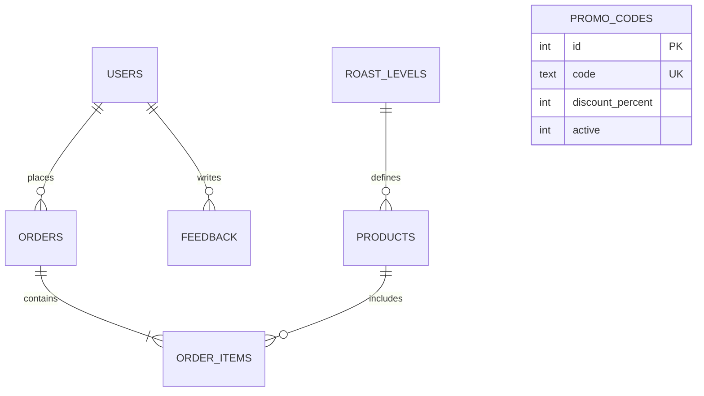

# Лабораторна робота № 4

## Реалізація бази даних для вебпроєкту

- **ПІБ:** [Данильчук Олександр]
- **Група:** [ІПЗ21]
- **Склад команди:** [Бондар Роман, Наконечний Михайло, Данильчук Олександр]
- **GitHub:** meqzxq
- **Тема проєкту:** Roastery — інтернет-магазин крафтової кави.
- **Репозиторій:** https://github.com/misha808/coffee-roastery

## Мета роботи

Набути практичних навичок роботи з реляційною базою даних та інтеграції операцій створення, читання, оновлення й видалення записів у вебзастосунку Flask.

## Особистий внесок

Моя частина командного проєкту — адміністративна панель. Я інтегрував підготовлені командою файли `routes/admin.py` та 11 HTML-шаблонів у `templates/admin/`, завантажив їх до спільного репозиторію та перевірив роботу застосунку локально.

Функціональність доданого модуля:

- загальна статистика магазину;
- перегляд, створення, редагування та видалення товарів;
- перегляд замовлень, зміна статусів і видалення замовлень;
- керування ступенями обсмаження;
- створення, вимкнення та видалення промокодів;
- перегляд і видалення відгуків;
- перегляд користувачів та зміна їхніх ролей.

Мій коміт: [Додано функціонал адміністративної панелі (21ce968)](https://github.com/misha808/coffee-roastery/commit/21ce968).

## Схема бази даних

У командному проєкті використовується SQLite. За документацією проєкту база містить такі таблиці:

| Таблиця | Первинний ключ | Інші поля та ключі |
|---|---|---|
| users | id | username (UNIQUE), password_hash, role, created_at |
| roast_levels | id | name (UNIQUE), description, color |
| products | id | name, description, price, roast_id (FK) |
| feedback | id | user_id (FK), message, created_at |
| promo_codes | id | code (UNIQUE), discount_percent, active |
| orders | id | user_id (FK), address, promo_code, discount_percent, total_price, status, date |
| order_items | id | order_id (FK), product_id (FK), quantity, unit_price |

Між замовленнями й товарами реалізовано зв’язок «багато-до-багатьох» через `order_items`. Промокоди не мають зовнішніх ключів: код і розмір знижки зберігаються у відповідному замовленні.

## Рівні завдання

- **Рівень 1:** адміністративне керування товарами, замовленнями та відгуками.
- **Рівень 2:** керування додатковою таблицею `roast_levels`.
- **Рівень 3:** адміністративне керування ролями користувачів і промокодами. Інші командні функції включають історію замовлень, пошук, фільтрацію та сортування каталогу.

## Хід роботи та тестування

Клоновано репозиторій за допомогою Git, додано файли адміністративного модуля, створено коміт і виконано push. Для локального запуску використано `python -m pip install -r requirements.txt` та `python app.py`.

Перевірено відкриття каталогу, додавання товару до кошика, вхід адміністратора, відображення адміністративної панелі та операції додавання, редагування й видалення тестового товару. Повне тестування всіх інших адміністративних операцій окремо не зафіксовано.

## Труднощі та їх вирішення

Під час першої спроби `git push` виникла помилка `fetch first`, оскільки віддалений репозиторій уже містив зміни іншого учасника. Виконано `git pull --rebase origin main`, після чого повторний `git push origin main` завершився успішно. Під час локального запуску браузер спочатку повідомив про відмову в підключенні; після запуску Flask і повторного відкриття локальної адреси застосунок став доступним.

## Висновки

Під час лабораторної роботи я отримав практичний досвід інтеграції адміністративного модуля у командний Flask-проєкт із SQLite та перевірив CRUD-операції для товарів. Також закріпив навички командної роботи з Git і синхронізації змін із віддаленим репозиторієм.
