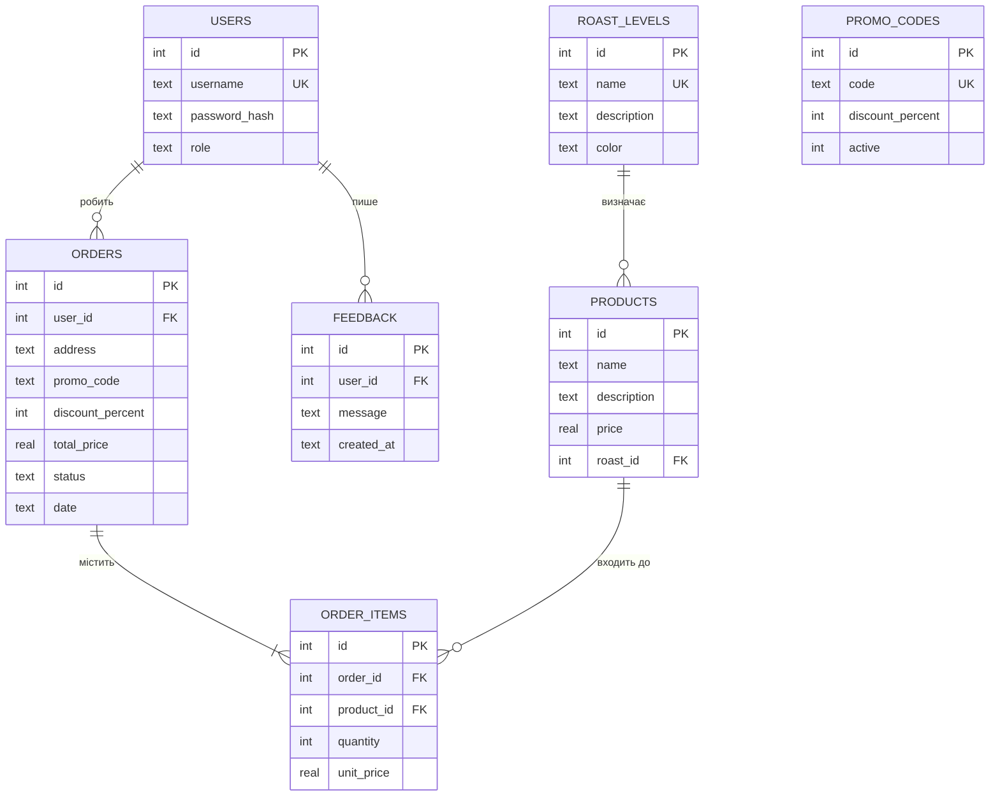
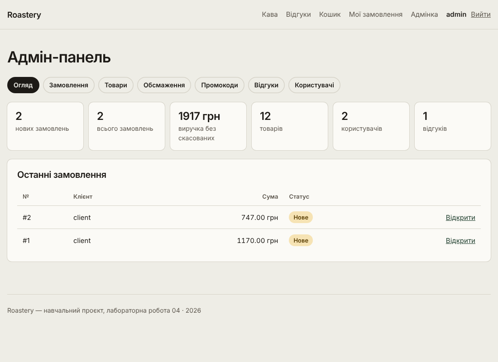
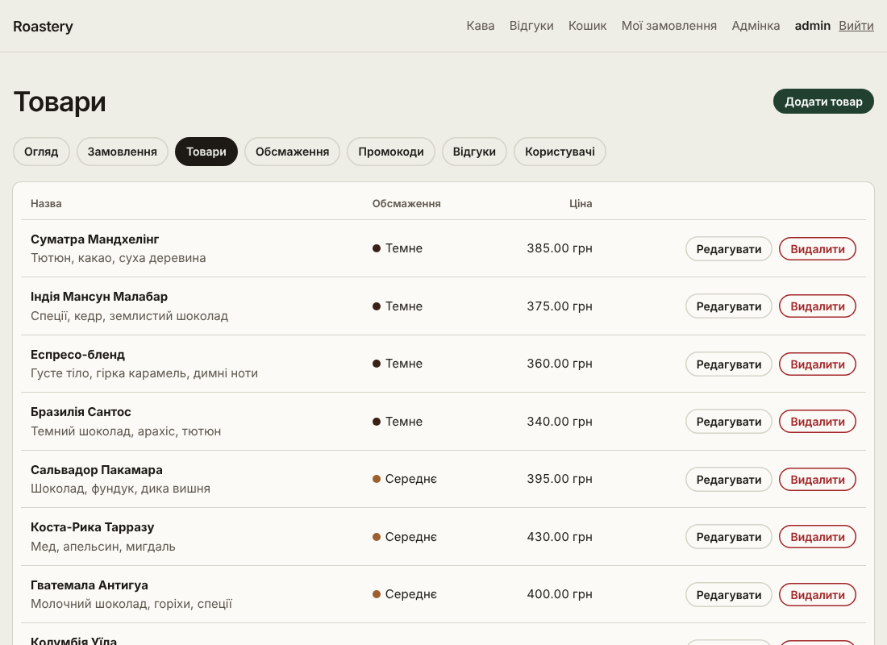
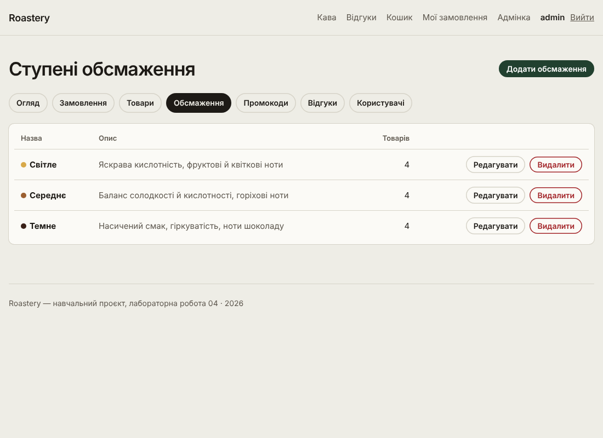
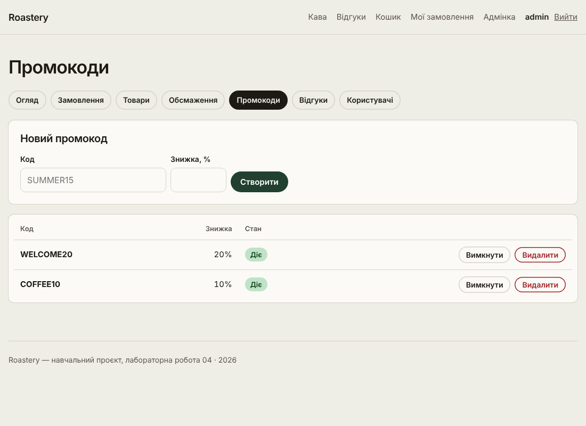
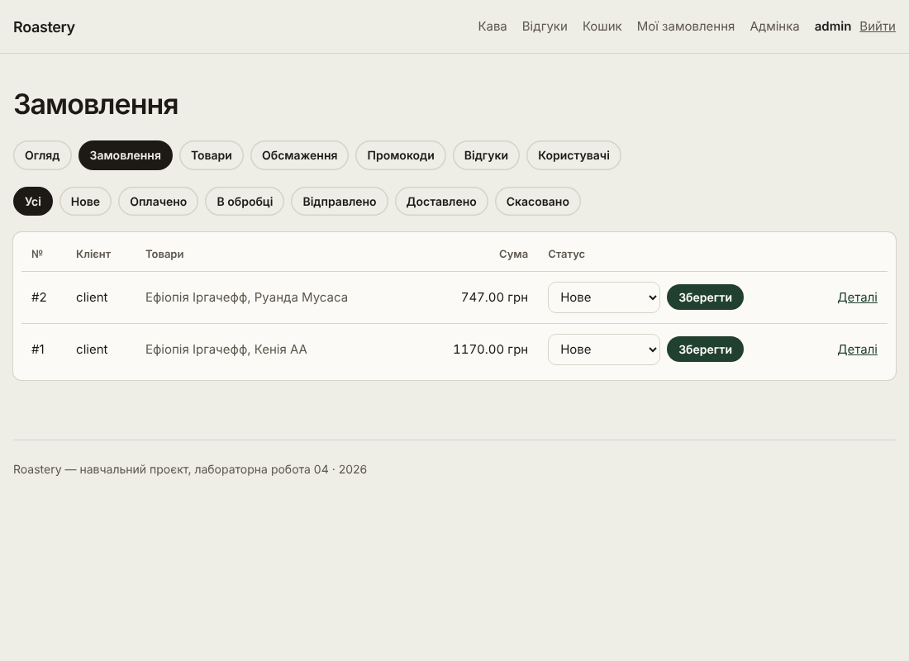
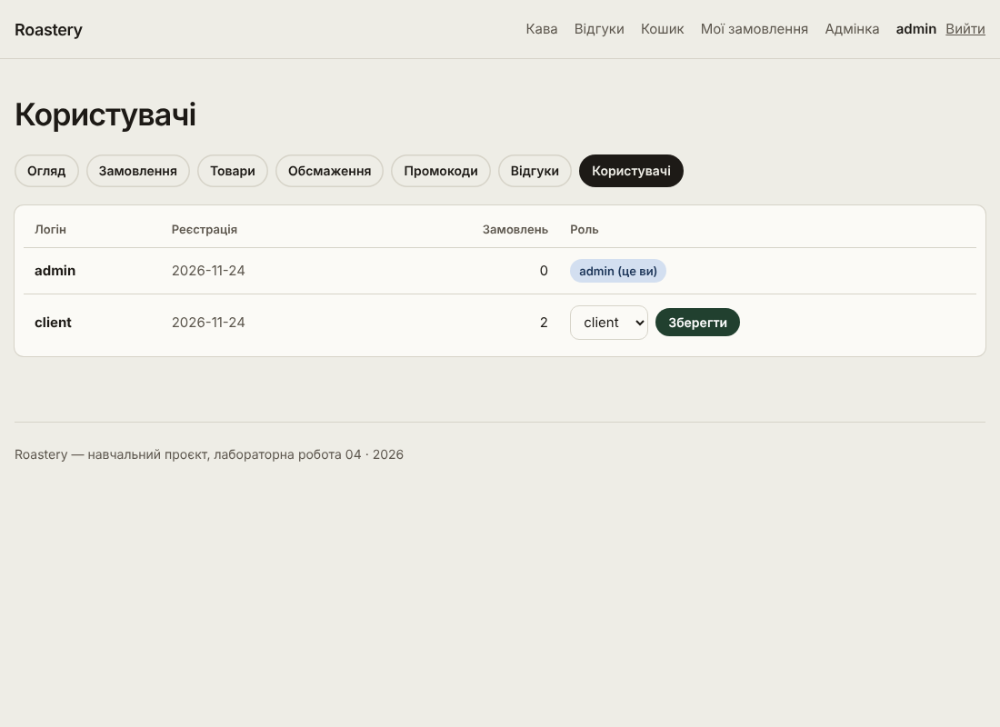
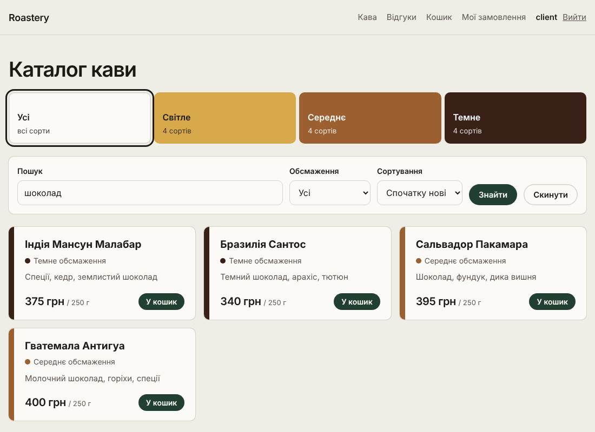
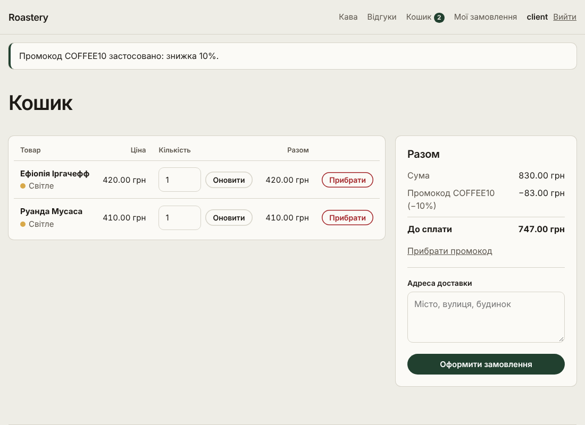
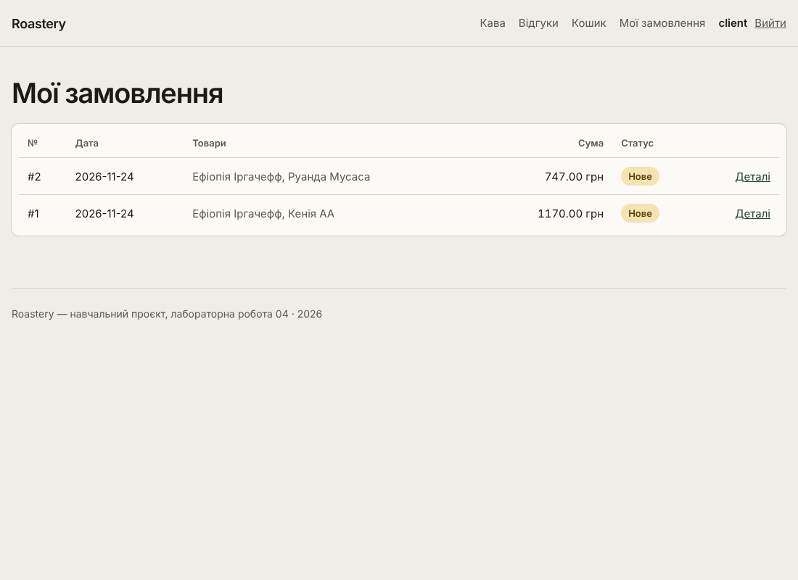

# Лабораторна робота 04. Реалізація бази даних для вебпроєкту

**ПІБ:** Наконечний Михайло
**Група:** ІПЗ-21
**Склад команди:** Наконечний Михайло, Бондар Роман, Данильчук Олександр
**Тема проєкту:** інтернет-магазин крафтової кави «Roastery» (Flask + SQLite)
**Репозиторій:** [https://github.com/misha808/coffee-roastery](https://github.com/misha808/coffee-roastery)

## Особистий внесок

**Роль у команді:** Архітектор бази даних, авторизація й ролі.

**Мої файли:** `app.py`, `models.py` (схема, таблиця `users`, функції доступу до даних), `init_db.py`, `seed_data.py`, `routes/auth.py`, `templates/base.html`, `login.html`, `register.html`, `error.html`, `static/style.css`, `README.md`, `TEAM.md`.

**Що зроблено:**
- Створив репозиторій, налаштував Flask-застосунок і конфігурацію (шлях до БД, секретний ключ, адміністратор за замовчуванням).
- Спроєктував усю схему бази даних (7 таблиць, зовнішні ключі, `CASCADE` / `RESTRICT`) і написав `models.py`: одне з'єднання на запит через `g`, `PRAGMA foreign_keys = ON`, параметризовані запити, транзакції.
- Реалізував рівень 3 «ролі користувачів»: реєстрація, вхід, хешування паролів (`werkzeug.security`), декоратор `login_required` і перевірка ролі для адмін-панелі.
- Зробив єдиний стиль сайту (`style.css`) і базовий шаблон.

**Мої коміти:** [https://github.com/misha808/coffee-roastery/commit/a7b4f98](https://github.com/misha808/coffee-roastery/commit/a7b4f98) (базовий застосунок: БД, авторизація, ролі, стиль)

## Схема бази даних

| Таблиця | Призначення | Ключі та зв'язки |
|---------|-------------|------------------|
| `users` | користувачі й ролі (`client` / `admin`) | PK `id`, унікальний `username` |
| `roast_levels` | ступені обсмаження кави (рівень 2) | PK `id`, унікальна `name` |
| `products` | товари (кава) | FK `roast_id` → `roast_levels` (`ON DELETE RESTRICT`) |
| `feedback` | відгуки клієнтів | FK `user_id` → `users` (`ON DELETE CASCADE`) |
| `promo_codes` | промокоди зі знижкою (рівень 3) | унікальний `code` |
| `orders` | замовлення | FK `user_id` → `users`; код і % знижки копіюються в замовлення |
| `order_items` | позиції замовлення | FK `order_id` → `orders` (`CASCADE`), FK `product_id` → `products` (`RESTRICT`) |

Зв'язок «багато-до-багатьох» між замовленнями й товарами реалізовано через проміжну таблицю `order_items`; у ній зберігається ціна на момент покупки (`unit_price`).

### Скріншоти

**Огляд адмін-панелі**

**Товари (додати / редагувати / видалити)**

**Ступені обсмаження: додаткова таблиця, рівень 2**

**Промокоди**

**Замовлення й керування статусами**

**Користувачі та ролі**

**Каталог із пошуком і фільтром**

**Кошик із промокодом**

**Історія замовлень клієнта**

## Труднощі та їх вирішення

1. **Циклічний імпорт.** Спочатку `app.py` імпортував Blueprint, а Blueprint — `get_db` з `app.py`, і Python видавав `ImportError`. Рішення: усі функції роботи з БД винесено в `models.py`, який не залежить від `app.py`.
2. **Зовнішні ключі не перевірялися.** SQLite за замовчуванням ігнорує `FOREIGN KEY`. Рішення: `PRAGMA foreign_keys = ON` при кожному підключенні.
3. **Паролі.** У першій версії вони зберігалися відкритим текстом. Замінив на хеші `pbkdf2:sha256`, перевірка через `check_password_hash`.

## Висновки

Я навчився проєктувати реляційну схему з обмеженнями цілісності та розумію, чим відрізняються `CASCADE` і `RESTRICT`. Також засвоїв, чому з'єднання з БД відкривають на кожен запит, а паролі зберігають лише у вигляді хешів.
