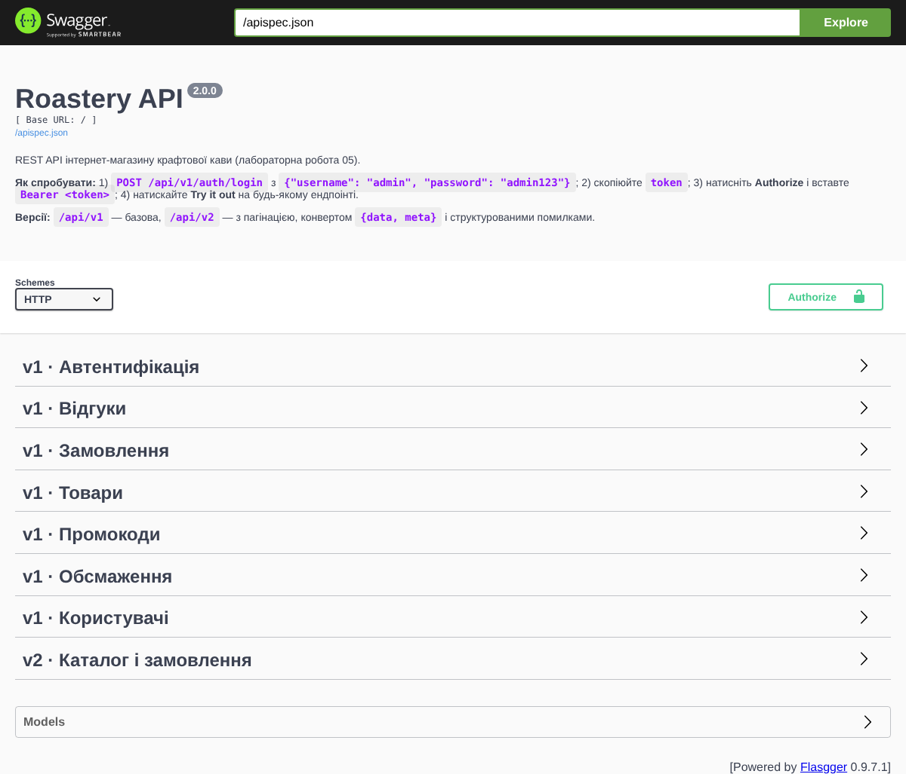
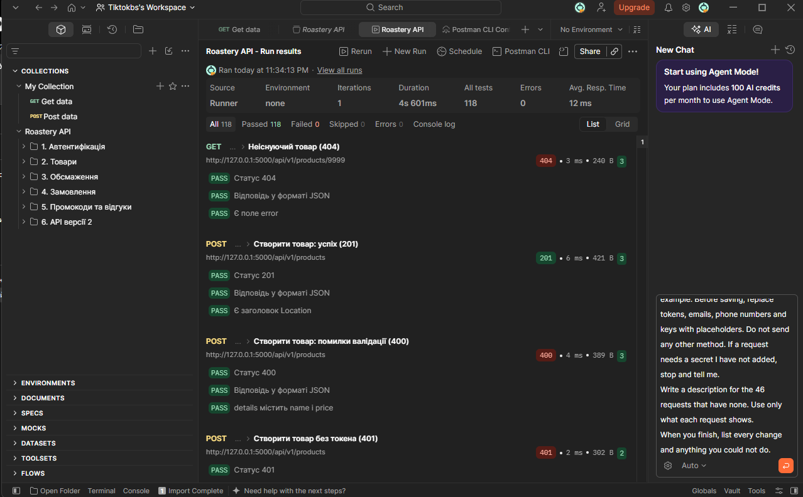
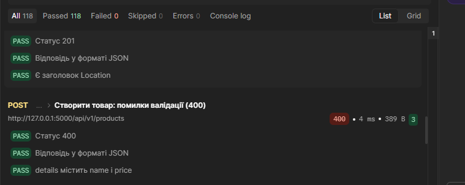

# Лабораторна робота №5

## Розробка RESTful API з документацією

**Виконав:** Олександр Данильчук

**Проєкт:** Roastery — інтернет-магазин крафтової кави.

## 1. Мета роботи

Розробити RESTful API для вебзастосунку, реалізувати обробку HTTP-запитів, валідацію даних, документацію Swagger та тестування за допомогою Postman.

## 2. Використані технології

- Python
- Flask
- SQLite
- REST API
- Swagger (Flasgger)
- Postman
- Git та GitHub

## 3. Особистий внесок

У межах лабораторної роботи мною додано:

- API для роботи із замовленнями.
- API для роботи з промокодами.
- API для створення та управління відгуками.
- Колекцію запитів Postman.
- Перевірку коректності відповідей сервера.
- Скріншоти результатів тестування.

Основні файли:

- `routes/api/orders.py`
- `routes/api/extras.py`
- `postman/roastery.postman_collection.json`
- `docs/postman-run-results.txt`

## 4. Реалізація рівнів складності

### Рівень 1

У командному проєкті реалізовано REST API, обробку HTTP-запитів, відповіді у форматі JSON та відповідні HTTP-коди стану.

### Рівень 2

Реалізовано інтерактивну документацію Swagger, яка дозволяє переглядати та тестувати ендпоінти API.



### Рівень 3

Реалізовано валідацію вхідних даних, структуровану обробку помилок, версіонування API та пагінацію.

## 5. Тестування в Postman

Для перевірки працездатності API використано колекцію з 46 HTTP-запитів.

Результати тестування:

| Показник | Результат |
|---|---:|
| Кількість запитів | 46 |
| Кількість перевірок | 118 |
| Успішні перевірки | 118 |
| Провалені перевірки | 0 |
| Помилки виконання | 0 |
| Середній час відповіді | 12 мс |
| Загальний час виконання | 4,601 с |

### Успішний запит (201 Created)



### Помилка валідації (400 Bad Request)



Усі 118 перевірок пройдено успішно. Сервер коректно обробляє як правильні, так і некоректні запити.

## 6. Запуск проєкту

Встановлення залежностей:

```bash
pip install -r requirements.txt
```

Запуск застосунку:

```bash
python app.py
```

- Сайт: http://127.0.0.1:5000
- Swagger: http://127.0.0.1:5000/apidocs/

## 7. Посилання на GitHub

Репозиторій:
https://github.com/misha808/coffee-roastery

Особистий коміт:
https://github.com/misha808/coffee-roastery/commit/b176f40

## 8. Висновок

Під час виконання лабораторної роботи було отримано практичні навички розробки RESTful API, обробки HTTP-запитів, валідації даних та тестування за допомогою Postman.

У командному проєкті реалізовано функціональність усіх трьох рівнів складності. Під час тестування успішно пройдено 118 із 118 перевірок.
