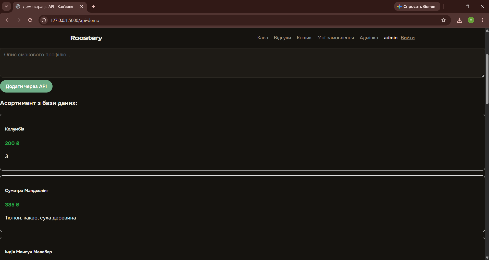
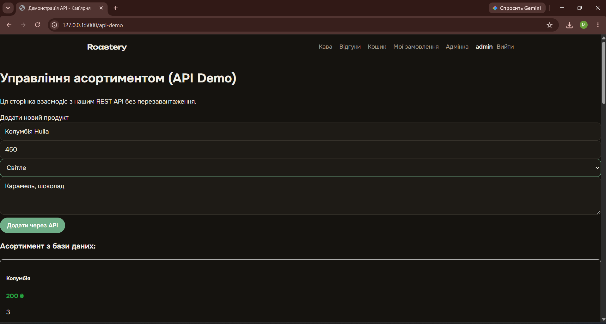
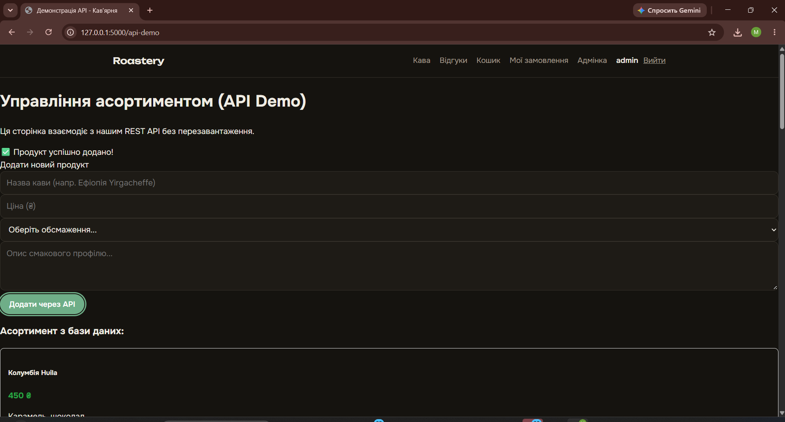
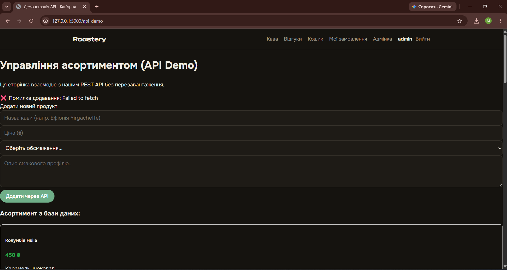

# Лабораторна робота 06. Інтеграція клієнтської частини з API

**Команда:** Наконечний Михайло, Бондар Роман, Данильчук Олександр
**Проєкт:** Інтернет-магазин крафтової кави «Roastery» (Flask + SQLite)
**Репозиторій:** [https://github.com/misha808/coffee-roastery](https://github.com/misha808/coffee-roastery)

## Опис демонстраційної сторінки
Реалізовано вебсторінку для управління асортиментом кави, яка підключається до нашого REST API за допомогою асинхронного JavaScript (Fetch API). Сторінка дозволяє переглядати поточний список товарів та динамічно додавати нові позиції через спеціальну форму без перезавантаження сторінки.

## Використані ендпоінти
Сторінка взаємодіє з маршрутом `/api/v1/products`:
- **GET** `/api/v1/products` — для отримання масиву всіх сортів кави.
- **POST** `/api/v1/products` — для створення нового товару (доступ лише адміністратору: JavaScript надсилає заголовок `Authorization: Bearer <token>`; токен сервер видає сторінці `/api-demo` для користувача, який увійшов на сайт). Передаються поля: `name` (назва), `price` (ціна), `roast_id` (id обсмаження, обирається зі списку), `description` (опис смаку).
- **GET** `/api/v1/roasts` — для наповнення випадаючого списку обсмажень у формі.

## Розміщення файлів
- **HTML-шаблон:** `templates/api-demo.html` (наслідує глобальний макет `base.html`).
- **JavaScript-логіка:** `static/js/api-demo.js`.
- **Маршрут (Python):** Функція `api_demo()` у файлі `app.py` за адресою `/api-demo`; вона передає в шаблон токен API поточного користувача.

## Скріншоти результатів
1. **Список даних з API**

2. **Додавання запису**

3. **Повідомлення про успіх**

4. **Повідомлення про помилку (сервер вимкнено — «Failed to fetch»)**

## Висновки
У ході виконання лабораторної роботи ми успішно інтегрували frontend-частину проєкту з існуючим REST API, використовуючи сучасні можливості Fetch API та синтаксис async/await. Було налаштовано динамічний рендеринг елементів на сторінці на основі отриманих JSON-даних. Також ми реалізували клієнтську валідацію форм і комплексну обробку HTTP-помилок (перевірка `response.ok`, показ повідомлення сервера та полів із `details`), що робить застосунок стійким до збоїв та забезпечує зручний користувацький досвід (UX).
